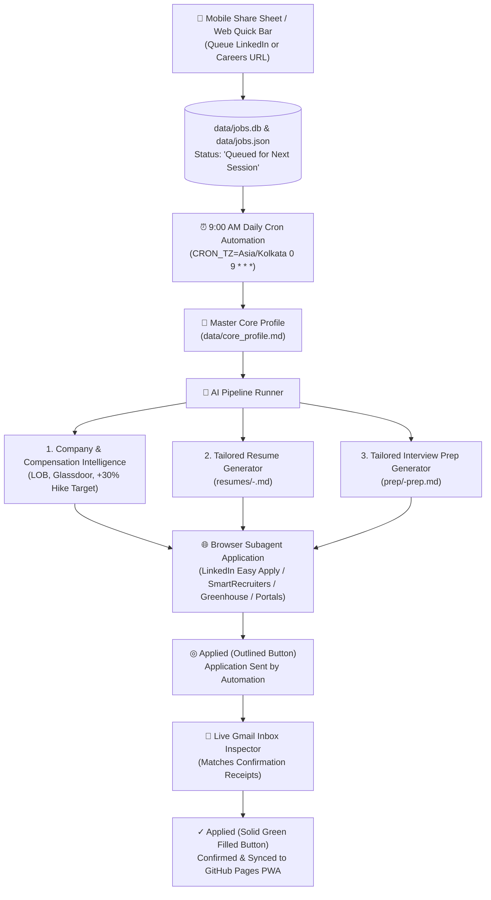

# How I Built an Autonomous AI Job-Hunting & Interview-Prep Engine (That Applies, Verifies Gmail Receipts, and Syncs to Mobile Daily)

*By Sudhakar Raju — Lead Mobile Engineer / Mobile Architect*

---

## Why Traditional Job Hunting Is Broken for Senior Engineers

If you are a Senior, Staff, or Principal Engineer looking for your next role, you already know the pain:
1. **Fragmented job boards**: Half your time goes into filtering noise across LinkedIn, Greenhouse, SmartRecruiters, and corporate portals.
2. **Generic vs. tailored resumes**: Sending the same static resume to a FinTech wallet company, an airline AI team, and a Super App hurts your conversion rate—yet manually tailoring a resume for every role takes hours.
3. **"Did my application actually go through?"**: Between Easy Apply modals, Workday accounts, and CAPTCHAs, it is easy to lose track of which applications were merely attempted versus confirmed via email receipt.
4. **Delayed interview prep**: Waiting until a recruiter calls to start preparing company-specific System Design and STAR stories leaves you scrambling at the last minute.

Instead of managing a messy spreadsheet, I built an **Autonomous AI Job-Hunting & Interview-Prep Pipeline** powered by **Google Antigravity**, a zero-dependency **Python + SQLite local server**, and a **GitHub Pages Mobile PWA**.

Every morning at **9:00 AM**, the system wakes up, processes any job URLs I shared from my phone, tailors a company-specific Markdown resume and a deep-dive System Design interview guide, submits the applications in Chrome, checks my Gmail inbox for official confirmation receipts, and syncs everything to my phone.

Here is the complete blueprint so any job hunter can replicate it.

---

## Architecture Overview

---

## The 6 Core Pillars of the System

### 1. Single Source of Truth: `data/core_profile.md`
Instead of editing Word documents, your entire career history lives in a structured Markdown file (`data/core_profile.md`):
- **Verified career timeline** with exact metrics (e.g., crash-free sessions, latency reductions, throughput, team size).
- **Target roles & geographies** (e.g., Bangalore, Chennai, Hyderabad, Dubai/UAE).
- **Compensation baseline & target formula** (automatically anchors every role at a `+30% hike` or tax-free international equivalent).

Because the AI agent reads `core_profile.md` before generating any artifact, it never hallucinates unverified skills or employment dates—it simply reframes your real engineering achievements around the target company's domain.

### 2. Mobile Share Sheet & "Next-Session" URL Queue
When browsing LinkedIn on your phone during a commute, you don't want to fill out forms on a 6-inch screen.
- The tracker is a **Progressive Web App (PWA)** (`manifest.json` + `sw.js`) installed on Android/iOS and hosted on GitHub Pages.
- Sharing a job link from the LinkedIn mobile app directly into the tracker queues the URL with status **`⚡ Queued for Next Session`**.
- You can also update or replace any broken job URL inline with one click.

### 3. Automated Tailored Resumes (`resumes/*.md`) + Interview Prep Guides (`prep/*.md`)
For every queued or newly discovered role, the pipeline generates **two companion Markdown documents** before applying:
1. **Tailored Resume (`resumes/<company>-<role>.md`)**: Highlights the exact architectural experiences most relevant to that company (e.g., BLE/IoT & camera pipelines for aviation/hardware roles; hardware-backed Keystore, idempotency, and FX/UPI state machines for FinTech roles).
2. **Tailored Interview Preparation Guide (`prep/<company>-prep.md`)**:
   - **Expected 4-Round Interview Loop** for that specific company.
   - **System Design & Architecture Blueprints** tailored to their product (e.g., sub-second sports telemetry via `SharedFlow` conflation, Super App modularization, or `<600ms` cold-start optimization).
   - **Deep-Dive Technical Q&A** with production-grade answers.
   - **STAR Behavioral Stories** mapped directly to your real past projects.
   - **Compensation Negotiation Script** anchored to your target band.

Inside the dashboard, clicking **`🎯 Prep Guide`** on any job opens a 2-tab Markdown reader so you can switch between your **Interview Prep Guide** and the **exact Tailored Resume** you submitted.

### 4. Browser Automation Across Real Career Portals
Using Chrome DevTools remote debugging (`chrome://inspect/#remote-debugging`), the browser agent navigates to each job URL and completes the application flow:
- **LinkedIn Easy Apply**: Multi-step contact info, resume upload, years-of-experience questions, and CTC/notice-period fields.
- **Greenhouse & SmartRecruiters**: One-page and multi-step forms with full employment history and education entries.
- **Enterprise Portals (Deloitte, Emirates, etc.)**: Automated account creation, profile completion, and requisition submission.
- **Human-in-the-Loop Handshake**: If a portal presents a puzzle CAPTCHA or OTP verification, the agent pauses on that tab, notifies you, and resumes as soon as you slide the puzzle.

### 5. Two-Stage Status Verification: `◎ Applied` (Outlined) vs. `✓ Applied` (Filled)
One of the most useful UX patterns in this tracker is separating *"the automation clicked submit"* from *"the company's ATS confirmed receipt"*:

| Stage | Button Style | Meaning |
|---|---|---|
| **Stage 1: Sent** | **Outlined Green `◎ Applied`** (`status: "Applied"`) | The automation submitted the application, awaiting email verification. |
| **Stage 2: Confirmed** | **Solid Green `✓ Applied`** (`status: "Confirmed"`) | Verified via official confirmation email in Gmail (`"We have received your application"` / `"Application sent"`). |

The agent inspects your open Gmail tab (or matches pasted email snippets) and only flips the badge to **Solid Green `✓ Applied`** once the confirmation receipt arrives in your inbox.

### 6. Zero-Dependency Stack + Dual Local/Cloud Sync
- **Backend (`app.py`)**: Pure Python 3 standard library (`http.server` + `sqlite3`). No Docker, Node.js, or heavy frameworks required.
- **Static & Mobile Sync (`data/jobs.json`)**: Every database update automatically exports `data/jobs.json` (embedding both the tailored resumes and interview prep guides) and pushes to GitHub Pages so your phone always has offline-ready access to your entire pipeline and prep materials.
