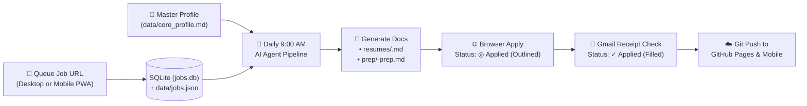

# 🚀 Autonomous AI Job-Hunt & Interview-Prep Pipeline

> **An end-to-end AI Career Command Center, Automated Application Runner, Gmail Receipt Verifier, and Tailored System Design Prep Generator.**
>
> 📖 **Read the companion article**: [ARTICLE.md](./ARTICLE.md) — *How I Built an Autonomous AI Job-Hunting & Interview-Prep Engine*

---

## ✨ Key Capabilities for Job Hunters

| Feature | What It Does |
|---|---|
| 📄 **Single Source of Truth (`data/core_profile.md`)** | Stores your verified career timeline, metrics, skills, target locations, and compensation formula in one clean Markdown file so the AI never hallucinates. |
| 🔗 **Next-Session Job URL Queue** | Paste any LinkedIn, Greenhouse, SmartRecruiters, or corporate job URL via the Web Quick Bar or Mobile Android Share Sheet (`⚡ Queued for Next Session`). |
| 🎯 **Tailored Resumes & Interview Prep Guides** | Automatically generates both a role-tailored Markdown resume (`resumes/<company>-<role>.md`) and a company-specific Interview Preparation Guide (`prep/<company>-prep.md`) with System Design blueprints, Technical Q&A, STAR stories, and negotiation scripts. |
| 🟢 **Two-Stage `◎ Applied` &rarr; `✓ Applied` Workflow** | Distinguishes between **Stage 1: Outlined `◎ Applied`** (application sent by automation) and **Stage 2: Solid Green `✓ Applied`** (verified via official confirmation receipt in Gmail). |
| 📱 **Installable Mobile PWA & GitHub Pages Sync** | Runs locally on `http://localhost:5050` with SQLite (`data/jobs.db`) and automatically exports `data/jobs.json` to GitHub Pages with offline Service Worker support (`manifest.json` + `sw.js`). |
| ⏰ **Daily 9:00 AM Automated Pipeline** | Scheduled background cron runner (`CRON_TZ=Asia/Kolkata 0 9 * * *`) that pulls queued URLs, discovers new roles, applies, verifies Gmail confirmations, and pushes updates to GitHub. |

---

## 🏗️ End-to-End Architecture



---

## ⚡ Quick Start (Fork & Customize for Your Own Job Hunt)

### 1. Clone the Repository
```bash
git clone https://github.com/sudhakar-r08/job-hunt-tracker.git
cd job-hunt-tracker
```

### 2. Customize Your Master Profile (`data/core_profile.md`)
Edit `data/core_profile.md` with:
- Your contact details (Email, Phone, Location, LinkedIn, GitHub).
- Your verified employment history and quantifiable engineering metrics.
- Your target roles, preferred locations, and compensation baseline (e.g., `+30% hike` target).

### 3. Initialize & Launch the Local Server
Requires only **Python 3** (zero external `pip` packages needed):
```bash
python3 app.py init
python3 app.py serve --port 5050
```
Open **http://localhost:5050** in your browser.

---

## 🛠️ CLI Commands Reference (`app.py`)

```bash
# Initialize SQLite database and sync data/jobs.json (embeds resumes & prep guides)
python3 app.py init

# Start the local web server on port 5050
python3 app.py serve --port 5050

# List all tracked jobs and their current status from the terminal
python3 app.py list

# Add or update a job record via JSON
python3 app.py add --data '{"company":"ExampleCorp","title":"Staff Mobile Architect","location":"Bangalore","job_url":"https://www.linkedin.com/jobs/view/...","status":"Queued for Next Session"}'
```

---

## 📂 Repository Structure

```text
├── app.py                     # Zero-dependency Python HTTP server, SQLite REST API & JSON/Prep exporter
├── index.html                 # GitHub Pages / Mobile PWA entry point
├── static/
│   └── index.html             # Responsive UI with 2-tab Prep Guide & Resume viewer, URL Scheduler & Gmail matcher
├── ARTICLE.md                 # Full article & architecture guide for fellow job hunters
├── manifest.json              # PWA Web App Manifest with Android Share Target support
├── sw.js                      # Offline-capable Service Worker
├── icon.svg                   # Vector app icon
├── data/
│   ├── jobs.db                # SQLite database storing tracked jobs and statuses
│   ├── jobs.json              # Auto-synced JSON payload (includes resumes & prep guides for Mobile/GitHub Pages)
│   ├── core_profile.md        # Master single-source-of-truth candidate profile
│   └── core_profile.json      # Structured profile metadata
├── resumes/                   # Role-tailored Markdown resumes generated per company
│   ├── youtrip-staff-mobile-engineer.md
│   ├── nagarro-mobile-architect.md
│   ├── deloitte-mobile-lead-architect.md
│   ├── emirates-mobile-architect-dubai.md
│   ├── phonepe-staff-mobile-architect.md
│   ├── careem-staff-mobile-architect.md
│   └── valuelabs-lead-android-developer.md
└── prep/                      # Role-tailored Interview Preparation Guides (System Design, Q&A, STAR, Comp)
    ├── youtrip-prep.md
    ├── nagarro-prep.md
    ├── deloitte-prep.md
    ├── emirates-prep.md
    ├── phonepe-prep.md
    ├── careem-prep.md
    └── valuelabs-prep.md
```

---

## ⏰ Daily Scheduled Automation Setup

To run the pipeline automatically every morning at **9:00 AM** in Google Antigravity:
1. Place the schedule configuration in `~/.gemini/config/sidecars/daily-job-hunt-assistant/sidecar.json` (`CRON_TZ=Asia/Kolkata 0 9 * * *`).
2. Enable Chrome remote debugging at `chrome://inspect/#remote-debugging` so the browser agent can submit applications and inspect your open Gmail tab for confirmation receipts.
3. Enable **"Daily Mobile Architect Job Hunter & Tracker"** in the Antigravity **Automations** panel (`Cmd+Shift+P` &rarr; `Antigravity: Open Automations`).
